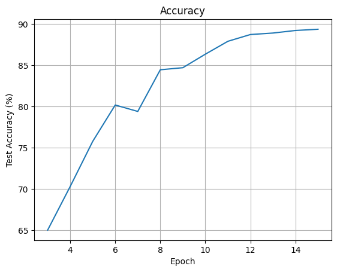
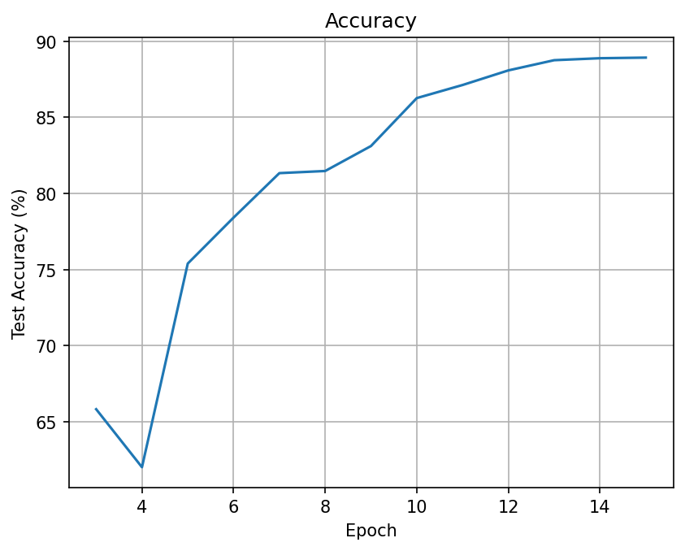

# CIFAR-10 Image Classification with ResNet9

Recovered ELEC5304 Project 2, Group 45 coursework. This repository restores the original Jupyter notebook, its saved training outputs and figures, plus instructions for running the experiment again.

## 小组作者

Jinhao Zheng, Yilin Wu, Huiwen Zhang, Yiqian Guo, Chengnan Zhu.

这是小组课程项目。原始可执行单元与训练输出保留，公开副本移除了学号及过时的交互控件元数据。本仓库没有将小组成果改写为个人独立完成。

## 模型和训练流程

- CIFAR-10：使用 Hugging Face `uoft-cs/cifar10` 数据集。
- 官方 50,000 张训练图像按固定随机状态 5304 分为 40,000 张训练与 10,000 张验证；官方 10,000 张测试图像单独保留。原 notebook 创建了验证集，但实际训练循环没有使用它。
- 训练增强：随机裁剪（padding=4）、随机水平翻转；张量转换后按 CIFAR-10 均值和标准差归一化。测试图像仅作张量转换和归一化。
- ResNet9：3×3 卷积、Batch Normalization、ReLU，通道数 32 → 64 → 128 → 256；64 和 256 通道阶段包含残差块，最后使用自适应最大池化与 10 类线性分类器。
- AdamW、CrossEntropyLoss、OneCycleLR，batch size 512，训练 15 个 epoch；CUDA 环境使用 AMP。
- 第 3 个 epoch 起记录测试准确率与累计耗时。

## 原始记录

下表来自找回的 notebook 中已经保存的输出，**不是本次恢复操作新测得的结果**。

| 指标 | 原 notebook 记录 |
| --- | ---: |
| 60 秒内最佳测试准确率 | 70.29%（第 4 轮，58.7 秒） |
| 15 轮最佳测试准确率 | 89.35% |
| 第 15 轮累计耗时 | 235.9 秒 |

原课程要求以 T4 GPU 为目标；保存的这些数字不构成对任意硬件的速度保证。代码未固定所有训练随机性，重新运行不会保证相同准确率。



历史 CSV 和两张原实验截图在 `results/historical/`，图片从原 notebook 提取。

## 如何运行

建议 Python 3.10 或 3.11。创建独立环境后，先按 [PyTorch 官方安装说明](https://pytorch.org/get-started/locally/) 安装适合本机 GPU 的 PyTorch 与 torchvision，再安装其余依赖。

```bash
python -m venv .venv
# Windows PowerShell
.venv\Scripts\Activate.ps1
# macOS / Linux
# source .venv/bin/activate

pip install -r requirements.txt
jupyter lab
```

打开 `ELEC5304_Project_2.ipynb`，选择环境对应内核，然后从头执行全部单元。也可以将 notebook 上传到 Google Colab，选择 GPU 运行时，先安装缺少的 `datasets` 包。

首次运行会下载 CIFAR-10，需要网络连接和足够的磁盘空间。Windows 本地 notebook 建议将 DataLoader 的 `num_workers=2` 改为 `num_workers=0`，避免 notebook 内定义的 Dataset 类引发多进程导入问题。原 notebook 的 autocast 使用 CUDA；完整复现实验建议使用 NVIDIA GPU。

## 结果解读

原作业反复使用测试集查看每轮表现，因此 89.35% 应表述为该课程实验的记录，不能等同于独立盲测、严格的最终泛化评估或新硬件上的复现指标。若要开展新的模型比较，应使用验证集选择超参数与模型，只在最终模型确定后评估测试集。

原文字说明曾将起始卷积描述为“全连接压缩”；代码实际使用卷积，模型结构以上面的代码说明为准。当前仓库未找回原训练权重，因此保留的曲线和日志不能代替可加载的原检查点。

## 数据来源

- [CIFAR-10 原始数据集](https://www.cs.toronto.edu/~kriz/cifar.html)
- [Hugging Face 数据集镜像](https://huggingface.co/datasets/uoft-cs/cifar10)


## 本次完整重跑

2026-10-18，在 NVIDIA GeForce RTX 4060 Laptop GPU 上，使用找回的原代码实际完成了 15 轮训练和测试：

| 指标 | 本次实测 |
| --- | ---: |
| 最佳测试准确率 | 88.93% |
| 60 秒内最佳测试准确率 | 78.42%（第 6 轮，59.6 秒） |
| 15 轮累计耗时 | 153.2 秒 |
| 训练 / 未使用的验证 / 测试样本数 | 40,000 / 10,000 / 10,000 |

本次仅将 DataLoader 的 `num_workers=2` 调整为 `0` 以适配 Windows；正式训练前运行了 eval 模式前向检查。模型、增强策略、优化器、学习率策略和轮数均沿用原 notebook。未固定所有随机种子，因此这是方法与运行流程的重跑，结果与原记录有合理差异。耗时包含训练循环和第 3 轮起的测试评估，不包含下载数据、构建数组和模型等准备工作。

- `results/reproduction/training_log.csv`：本次逐轮结果。
- `results/reproduction/summary.json`：环境版本、数据规模、运行调整与结果摘要。
- `results/reproduction/accuracy_curve.png`：本次测试准确率曲线。



验证包括 notebook 格式和所有 11 个代码单元的语法检查、GPU 前向和反向传播的数值检查，以及完整 15 轮真实 CIFAR-10 训练。仅有无界面绘图的 `plt.show()` 提示，曲线已实际保存。新训练得到的最终权重保存在本地 `results/reproduction/resnet9_rerun_final.pth`，未纳入 Git；仓库中的 89.35% 历史记录与本次 88.93% 结果分开保存。
